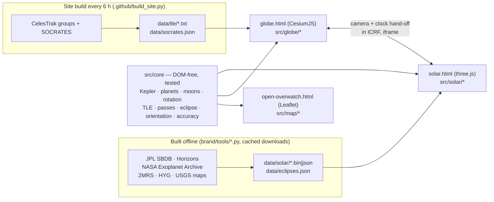

# Open Overwatch

**From your street to the cosmic web, live.** 18,000+ satellites (every active one plus three debris clouds), storms,
quakes and tonight's sky, then the planets, 1.57 million asteroids, the planets of other stars and 43,480 galaxies, in
**one continuous zoom**. Positions are checked against NASA JPL. It runs in your browser (phones too), with no install,
no account and no build step.
Live aircraft come with the free download.

**▶ [Website](https://destinjones.github.io/open-overwatch/) · [3D globe](https://destinjones.github.io/open-overwatch/globe.html) · [Solar System](https://destinjones.github.io/open-overwatch/solar.html) · [2D ops map](https://destinjones.github.io/open-overwatch/open-overwatch.html)** · [the 30 s clip (MP4)](brand/clip/open-overwatch-zoom.mp4)

## What you can do
- **Zoom from a street to the cosmic web without a cut.** The 3D globe hands its camera to the Solar System view past the
  Moon (same pixels, same instant, one clock), and takes it back when you zoom into Earth.
- **Tonight, for any place.** What you can see tonight (passes of the ISS and bright satellites, the planets, the Moon,
  meteor showers, the aurora chance, how dark the sky is), sunrise and moonrise to the minute, for where you are or for
  any town you type. A link (`tonight.html#at=18.52,73.86&name=Pune`) opens it over that place, and `#embed=1` makes it
  a light card for another web page.
- **Look up.** On a phone, hold it to the sky: the camera follows the motion sensors and shows what is above you right
  now. That includes satellites, the planets and the bright stars (and aircraft with the free download), plus your next ISS pass.
- **Watch near misses happen.** The closest upcoming conjunctions in orbit (CelesTrak SOCRATES): pick one and the
  clock jumps to 45 s before closest approach, with both objects and their orbits on screen.
- **See the 2027 eclipse before it happens.** The Moon's shadow crosses the globe for every solar eclipse of 2027–2030,
  with how much of the Sun each one covers from where you are.
- **Follow the missions.** 28 spacecraft on NASA JPL Horizons tracks, from Voyager to Juno's orbits around Jupiter and
  ISRO's Chandrayaan-2 around the Moon and Aditya-L1 at the Sun-Earth L1 point.
- **Fly into another solar system.** 6,339 exoplanets at their real stars. TRAPPIST-1's seven worlds orbit at their real
  speeds, positioned from their measured transit times, with the habitable zone drawn in.
- **Light is slow at this scale.** A "ghost" shows where Earth actually sees Jupiter (49 light-minutes ago), and our
  radio bubble (everything broadcast since 1920) lights up the stars it has reached.
- **Know where each item came from.** Every live card says which sources reported it, how many agree and how old the
  data is: an earthquake that USGS and EMSC both list, with EMSC's own solution rather than a copy of USGS's, reads
  "confirmed".
- **2D ops map:** ships, quakes, storms, radar, cameras and news on one dark map. Live aircraft and military flights
  come with the free download.
- **Ask Claude about it.** The MCP server in [`mcp/`](mcp/README.md) has 38 tools that answer questions about
  earthquakes, satellites and their passes, launches, storms, ships, weather, the aurora and tonight's sky from the same
  open data, each answer with a link into the globe; in Claude Desktop the live globe appears in the chat. No account,
  no keys.

## How it's built

- **No build step.** The pages load ES modules from `src/`, and the libraries (CesiumJS 1.146, three.js 0.186,
  Leaflet 1.9, satellite.js 5) come from CDNs; the satellite workers use a copy of satellite.js in `src/vendor/`.
- **One frame of reference:** heliocentric ecliptic J2000, AU and Julian dates in the Solar System view. Earth-fixed
  positions use Cesium's IAU 2006 rotation, and the hand-off between the two views goes through the ICRF.
- **1.57M asteroids in one draw call per file:** 15-byte packed orbital elements, with Kepler's equation solved per
  point in the vertex shader every frame.
- **18,000+ satellites** propagated with SGP4 in a web worker; the dots follow the clock at any speed and in reverse.
- **A log depth buffer** spans 24 orders of magnitude: from 150 m to 16 billion light-years in one scene.

## Accuracy (measured on 2 Oct 2026 against JPL Horizons; the tests hold them within the formulae's limits)
| | Error vs NASA JPL |
|---|---|
| Planets (JPL approximate elements) | 1.5″ (Uranus) to 4.4′ (Saturn) |
| Moon | 0.9′ · 189 km |
| 20 major moons (orbits fitted to Horizons) | ≤ 0.4° (Io 0.75′, Titan 0.09′) |
| Eclipse of 2 Aug 2027 | greatest eclipse 25.51°N 33.16°E, 10:06:39 UT, 6 min 27 s (NASA: 25°31′N 33°08′E, 6 min 23 s) |
| Satellites | SGP4 from public element sets: ~1 km at epoch, 1–3 km/day after |

These are the errors on one date, the test fixture of 2 October 2026. The tests allow more, the limits of the formulae
(Saturn 15′, Jupiter 12′, the Moon 12′, the moons in the fixture 1°), and the app's "Under the hood" panel repeats the
measurement live.

## Speed
Measured with `brand/tools/perf.mjs`, `zoomtest.mjs` and `mobile_journey.mjs`; details are in
[docs/PERFORMANCE.md](docs/PERFORMANCE.md).

| | |
|---|---|
| Desktop (RTX 3060) | 165 fps (the display's refresh rate) in every view at rest; ~120 fps flying the globe; 5 frames over 50 ms in an 18 s round trip from Earth to the stars and back |
| Phone (emulated mid-range Android, 4G) | globe on screen in 6.4 s / 4.9 MB; Solar System in 4.1 s / 3.2 MB |
| Adaptive | High / Balanced / Low graphics; Auto starts on Low on phones and software WebGL and steps down when frames run slow; Low draws at 0.75 of the resolution (0.66 on phones) with no FXAA or limb halo, capped at 30 fps; Starlink's ~8,000 dots start off on phones |

## Run it
- **Online:** use the links above.
- **Locally:** `node serve.js` (or `python3 serve.py`), then open http://127.0.0.1:8787/.
  - The helper relays the few feeds that send no CORS headers. That adds live aircraft and military flights on the
    globe and the 2D map, which the website can't show.
  - Windows: `Start Open Overwatch.bat`.
- **Tests:** `npm install` once (the MCP server's one dependency), then `node --test`: over 800 tests, from JPL Horizons
  fixtures and textbook identities to every MCP tool against canned feeds. CI also checks every module's syntax and every
  page's links.

| Path | What |
|---|---|
| `src/core/` | the maths, DOM-free and unit-tested |
| `src/globe/`, `src/solar/`, `src/map/` | the three views |
| `mcp/` | the MCP server for Claude and other AI apps ([setup](mcp/README.md)) |
| `brand/tools/` | data builders (Python), performance and capture tools (Node, headless Chromium over CDP), Blender scripts |
| `docs/` | [architecture](docs/ARCHITECTURE.md), [data sources and licences](docs/DATA_SOURCES.md), [performance](docs/PERFORMANCE.md), notes |

## Credits
NASA JPL (SBDB, Horizons, approximate planetary elements), NASA Exoplanet Archive, NASA GIBS (Blue Marble, Black
Marble), NASA/GSFC SVS Deep Star Maps, USGS Astrogeology and NASA/JPL/SSI moon maps (Phobos: ESA/DLR/FU Berlin,
CC BY-SA 3.0 IGO), 2MASS Redshift Survey (Huchra et al. 2012), HYG v4.1 (CC BY-SA), Solar System Scope textures
(CC BY 4.0), the Milky Way artwork by NASA/JPL-Caltech/R. Hurt, and CelesTrak (GP data, SOCRATES).
Live feeds: adsb.lol, adsb.fi, airplanes.live, OpenSky, USGS, EMSC, NOAA, NASA EONET/FIRMS, GDACS, GDELT, Digitraffic,
aisstream.io, SondeHub, RainViewer, TeleGeography. OpenSky's data (download version): Matthias Schäfer, Martin
Strohmeier, Vincent Lenders, Ivan Martinovic and Matthias Wilhelm, "Bringing Up OpenSky: A Large-scale ADS-B Sensor
Network for Research", IPSN 2014. Basemap: Powered by Esri (Esri, Vantor, Earthstar Geographics, and the GIS User
Community). Full list with terms:
[docs/DATA_SOURCES.md](docs/DATA_SOURCES.md). These are public and volunteer services; check each one's terms before
any commercial use.

## Fork it, build on it, or take it over
I vibe code this with Claude (an AI): I describe what I want, Claude writes and tests it, and I try to make good calls. It surely has bugs. Please download it, fork it and build anything you like, no need to ask. If you'd like to take the whole project over, a hand-off is what I'd prefer: open an issue and say so.

Want to help? [CONTRIBUTING.md](CONTRIBUTING.md) gets you from a clone to a running, tested copy in a few minutes (or one click with the [dev container](.devcontainer/README.md)), with a list of good first issues. What changed when: [CHANGELOG.md](CHANGELOG.md). How the project is run and handed over: [GOVERNANCE.md](GOVERNANCE.md). Security problems: [SECURITY.md](SECURITY.md).

## Credit and licence
Open Overwatch is by [Destin Jones](https://destinjones.github.io/open-overwatch/about.html) ([GitHub](https://github.com/destinjones)), built in public with Claude as the building partner.
Also by me: [Ironbound](https://destinjones.github.io/godot-open-rts/), a free open source RTS made with Godot, and [CarFinder](https://destinjones.github.io/carfinder/), every new car on sale in 11 countries with what it really costs.

The code is MIT licensed ([LICENSE](LICENSE)): use it, fork it, build on it, and keep the copyright line. The data, maps, textures and models it shows belong to their sources and keep their own licences: see [docs/DATA_SOURCES.md](docs/DATA_SOURCES.md).
If you write about it or build on it, please credit it: *Jones, D. (2026). Open Overwatch [Computer software]. https://github.com/destinjones/open-overwatch* (GitHub's "Cite this repository" button reads [CITATION.cff](CITATION.cff)).

**Read the notices** at the bottom of [the site](https://destinjones.github.io/open-overwatch/#legal): no warranty, not for safety use, other people's data can be wrong or faked, and a specific warning about weather-balloon data (anyone can upload it; the layer is off by default and asks first).
